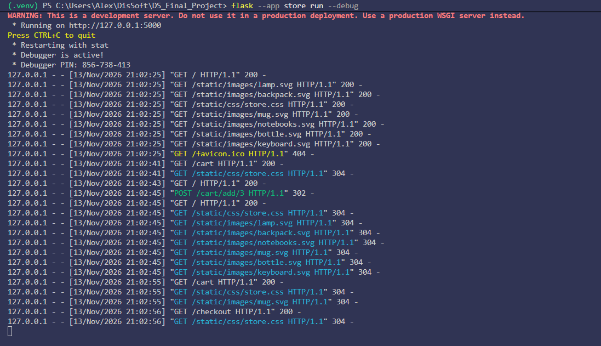
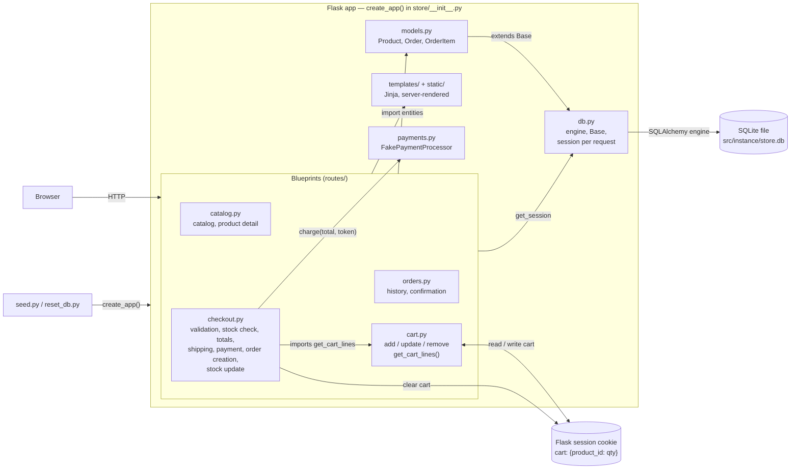
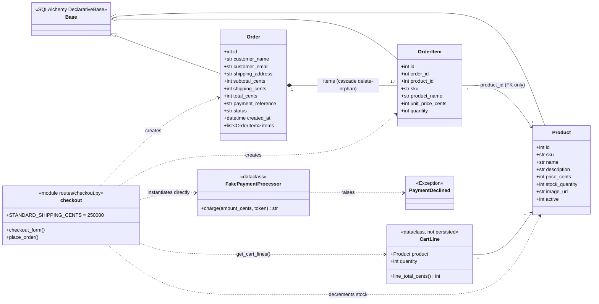

# Milestone 1 — Understand & Establish the Baseline

> **Understand before you redesign.**

## 1. Team & Store

- **Team members:**
  - Andres Juarez
  - Alejandro Fernández Arias
  - Allison Briseyda Ávila Moctezuma
  - Isaac Alejandro García Ruiz
  - Alejandro Amarillas Coronado
  - Ever Zaragoza Cerpas
- **Store name:** Semiusados.com
- **Store vertical / concept:** Online marketplace for used cars (seminuevos).
- **Repository:** https://github.com/alxfdez/DS_Final_Project
- **Short product description:** Semiusados.com sells inspected used cars with a fixed, non-negotiable price and home delivery. Each listing shows year, mileage, transmission, fuel and city; inventory is low (1–3 units per model), so a car is marked **"Vendido"** as soon as its stock reaches 0.

## 2. Baseline Validation

- [x] Application runs from a clean setup. `pip install -e ".[dev]"` → `python seed.py` → `flask --app store run --debug` serves the catalog (verified on Windows and with the original starter catalog before customizing). `python -m pytest` → `12 passed` on the untouched starter, and again `12 passed` after the storefront customization (PR #1).
- [x] Existing automated tests pass locally.
 
- [x] GitHub Actions CI passes.
 Workflow `tests` is green on every run: the initial commit, PR #1 (`pull_request` and `push`), the merge into `main`, and this document's commits.
- [x] Catalog → cart → checkout → order flow works end-to-end. 
 
 Reserved the *Ford Ranger XLT 4x2 2019* (`SEMI-0008`) → cart → checkout with `tok_success` → redirected to **Pedido #1**, total $452,400.00 MXN ($449,900 + $2,500 delivery). With `tok_fail` the payment is declined and no order is created (also covered by `test_payment_failure_does_not_create_order`).- [x] Orders and inventory changes persist after restarting the app.
  After stopping and restarting the server, a direct SQLite query shows:
  - `orders`: `(1, 'Cliente Prueba', 45240000, 'pay_6879cd4cc39d', 'confirmed')`
  - `order_items`: `(1, 'SEMI-0008', 'Ford Ranger XLT 4x2 2019', 44990000, 1)`
  - `products`: `('SEMI-0008', 0)`, with the stock going from 1 to 0
  
  The catalog shows the car as "Vendido" and `/orders` still lists Pedido #1.

## 3. Current System Design
  
**Defect found and corrected during validation.** On Windows, `python reset_db.py` always failed with `PermissionError: [WinError 32]`, even with no server running. `reset_db.py` calls `create_app()` only to read the database path. `create_app()` runs `create_all`, which leaves a pooled SQLAlchemy connection open on `store.db`, and Windows cannot delete an open file. Linux and macOS can, which is why CI (Ubuntu) never caught it. The fix is one line: `app.extensions["store_engine"].dispose()` before `unlink()` (PR #1).

Diagram made with Mermaid. Arrows mean "depends on / calls".

The payment provider is simulated in-process. `FakePaymentProcessor.charge()` succeeds for any non-empty token except `tok_fail`, and the checkout route creates the processor directly.

### 3.1 Class diagram (domain model as implemented)

Complements the module diagram above with the classes that actually exist in the code. `checkout` is not a class; it is shown as a `<<module>>` because it is where the purchase is coordinated.

What the class diagram shows:

- **`Order` owns its `OrderItem`s (composition).** `cascade="all, delete-orphan"` means items cannot exist without their order.
- **`OrderItem` references `Product` only through the `product_id` foreign key.** There is no ORM `relationship`. Displaying an order never reads `Product`, because `sku`, `product_name` and `unit_price_cents` are copied into the item when the order is placed.
- **`CartLine` is not persisted.** It is a request-scoped value built from the session cart (`{product_id: qty}`) plus a database lookup.
- **`checkout` depends on almost every other class.** This is the coupling described in observation 3.

## 4. Responsibilities & Dependencies

| Part / module | Main responsibility | Important dependencies |
|---|---|---|
| `store/__init__.py` (`create_app`) | Builds the Flask app, loads config (secret key, DB path, `STORE_NAME` = `Semiusados.com`), initializes the database, registers the four blueprints, and defines the `money` filter (cents → `$1,234.56 MXN`). | Flask, `db.init_app`, route blueprints |
| `store/db.py` | Creates the SQLAlchemy engine and session factory, creates the tables (`create_all`), provides one session per request (`get_session`) and closes it on teardown. | SQLAlchemy, Flask `g` / app context, `models` (imported to register the tables) |
| `store/models.py` | Defines `Product`, `Order` and `OrderItem`. Money is stored as integer cents, and order items keep a copy of the SKU, name and unit price. | SQLAlchemy, `db.Base` |
| `routes/catalog.py` | Lists active products and shows product detail (404 if missing or inactive). | `db`, `Product`, templates |
| `routes/cart.py` | Session-based cart: add / update / remove, plus `get_cart_lines()`, which turns session entries into `CartLine` objects. | Flask `session`, `db`, `Product` |
| `routes/checkout.py` | Shows the checkout form. On POST: validates fields and stock, computes totals (flat delivery fee `STANDARD_SHIPPING_CENTS = 250_000`, i.e. $2,500 MXN this changes from the baseline that is 99.0), charges the payment, creates the `Order` and its `OrderItem`s, decrements stock, commits and clears the cart. | `cart.get_cart_lines`, `payments`, `db`, `Order`, `OrderItem`, Flask `session` |
| `store/payments.py` | Simulated payment provider: returns a payment reference or raises `PaymentDeclined`. | None (stdlib only) |
| `routes/orders.py` | Order history and order confirmation page. | `db`, `Order` |
| `seed.py` / `reset_db.py` | Development scripts: load the used-car catalog, or delete the SQLite file. Both build the full app through `create_app()`. | `create_app`, `db`, `Product` |
| `tests/` + `.github/workflows/tests.yml` | Pytest suite using the Flask test client and a temporary SQLite database per test. CI runs it on every push and PR. | `create_app`, `models` |

**Main purchase flow (browser request → order persistence):**

1. The browser sends `POST /cart/add/<id>`. `cart.add` checks that the product exists and is active, increments its quantity in the session cart and redirects back.
2. `GET /cart` and `GET /checkout` call `get_cart_lines()`, which reads the session cart and loads each `Product` from SQLite. Checkout adds the flat delivery fee to the subtotal.
3. The customer submits `POST /checkout` with name, email, address and payment token. `place_order` rebuilds the cart lines and rejects the request if any field is missing or any quantity exceeds `stock_quantity`.
4. It computes `subtotal + STANDARD_SHIPPING_CENTS` and calls `FakePaymentProcessor().charge(total, token)`. On `PaymentDeclined` it flashes an error and redirects back without touching the database.
5. On success it creates an `Order` (`status="confirmed"`) and flushes to get its id. Then it appends one `OrderItem` per line, copying the SKU, name and unit price, and subtracts each quantity from `Product.stock_quantity`.
6. A single `db.commit()` saves the order, its items and the inventory changes together. The session cart is cleared and the browser is redirected to `/orders/<id>`, which loads the order with its items (`selectinload`) and renders the confirmation.

## 5. Design Observations

**What we observe now:**

1. **Strength — clear, small module boundaries.** Routes are split into one blueprint per feature, persistence is isolated in `db.py` / `models.py`, and the payment provider lives in its own module. `create_app(test_config)` lets tests inject a temporary database, which is why the 12 tests are fast and isolated (`conftest.py` creates a fresh SQLite file per test). Customizing the store for M1 only touched templates, CSS, images, `seed.py` and one constant, with no structural changes.
2. **Reasonable original decisions for the current problem.**
   - Money is stored as integer cents, so there are no float rounding errors.
   - The cart lives in the session: no cart tables and no login needed.
   - `OrderItem` copies the SKU, name and unit price, so past orders do not change when the catalog changes.
   - The whole order is written in one transaction.
   
   For a single store with one delivery option and a simulated payment, this is simple and sufficient.
3. **Coupling / design pressure — `place_order` does many jobs.**
   - In `routes/checkout.py`, one handler validates input, checks stock, computes totals, calls the payment provider, creates the order and updates inventory.
   - The checkout route imports `get_cart_lines` from `routes/cart.py`, so one route module depends on another.
   - The subtotal calculation is repeated in `view_cart`, `checkout_form` and `place_order`.
   
   It is readable today, but this is where changes to pricing, shipping or payment would pile up.
4. **Potential technical debt — checkout ordering and concurrency.**
   - Stock is checked first, then the payment is charged, and only after that is the order committed and the stock decremented. If the commit failed after a successful charge, nothing reverses the charge.
   - Two simultaneous orders for the last unit could both pass the stock check. This matters for a store where most cars have stock 1.
   - `FakePaymentProcessor` is created directly inside the route, so changing how payment works means editing the handler.
5. **Small robustness gaps and hidden dependencies.**
   - `cart.update` does `int(request.form.get("quantity", "1"))`, so a non-numeric value raises `ValueError` (HTTP 500).
   - The cart does not check stock; that only happens at checkout.
   - `/orders` lists every order, with no way to tell which customer is viewing.
   - `created_at` is stored in UTC and shown without converting to local time.
   - `Product.active` is an integer flag rather than a boolean.
   - The maintenance scripts build the whole app with `create_app()` just to find the database path. That hidden dependency caused the Windows `reset_db.py` defect (now fixed).
   
   None of the remaining gaps break the current baseline flows.

**What we might consider only if future requirements justify it** (not part of this milestone): if pricing, shipping or payment rules start changing, the totals and order-creation logic in `place_order` is the first place where the pressure will show. If real payments or concurrent shoppers become a requirement, the charge/commit ordering and the stock check will need attention. We are **not** changing the structure now, and we are not adding layers, interfaces or patterns in advance.

## 6. AI Use

- **Tool:** Claude Code (Anthropic), used in the IDE / desktop app.
- **What it helped with:**
  - Reading the starter code and summarizing modules, dependencies and the checkout flow.
  - Generating the used-car seed catalog, the SVG car illustrations, the Spanish templates and the CSS palette (PR #1).
  - Diagnosing the Windows `reset_db.py` lock (it showed that the script's own engine held the connection open) and proposing the one-line fix.
  - Drafting and reviewing this document and the Mermaid diagram (it found the inaccurate `Models → SQLite` arrow in our first draft).
- **What the team reviewed, corrected or validated itself:**
  - Chose the store concept and name.
  - Reviewed and approved PR #1.
  - Ran `pytest` locally and checked GitHub Actions.
  - Ran the purchase flow manually and checked persistence after restarting.
  - Designed the UML diagram, and reviewed the responsibilities table and each design observation against the source code.
  - The team is responsible for, and able to explain, every statement in this document.
