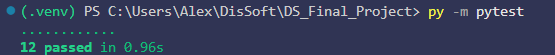
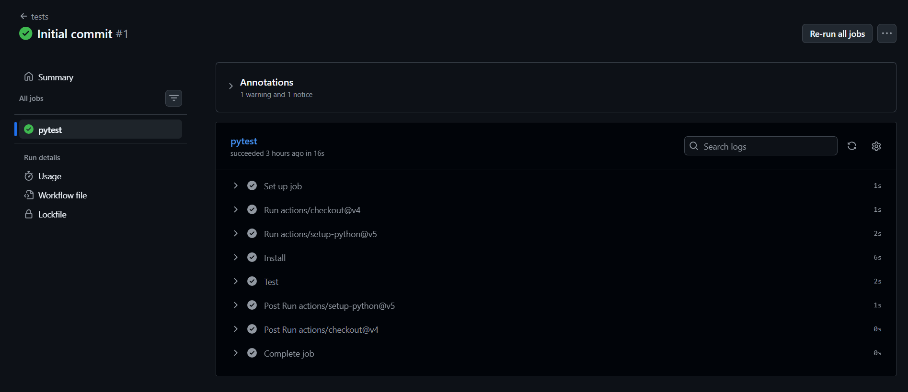
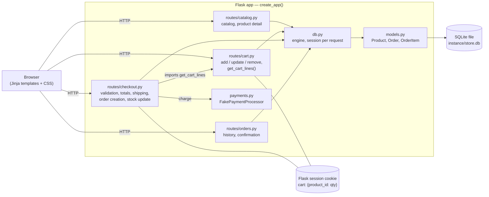

# Milestone 1 — Understand & Establish the Baseline

> **Understand before you redesign.**

## 1. Team & Store

- **Team members:** Alejandro Amarillas Coronado, Allison Briseyda Avila Moctezuma, Alejandro Fernández Arias, Isaac Alejandro Garcia Ruiz, Andres Juarez, Ever Zaragoza
- **Store name:** Semiusados.com
- **Store vertical / concept:** A storefront where customers browse a catalog of vehicles and place an order.
- **Repository:** https://github.com/alxfdez/DS_Final_Project.git
- **Short product description:** Semiusados.com is a web storefront for buying automobiles online. Customers browse the vehicle catalog, view each vehicle's details, add it to a cart, check out with a simulated payment, and review their order history.

## 2. Baseline Validation

Briefly record the evidence that your team verified the starter system before redesigning it.

- [x] Application runs from a clean setup. 
- [x] Existing automated tests pass locally.
 
- [x] GitHub Actions CI passes.

- [x] Catalog → cart → checkout → order flow works end-to-end. 

- [x] Orders and inventory changes persist after restarting the app.

## 3. Current System Design
  

 
The payment provider is simulated in-process: `FakePaymentProcessor.charge()` succeeds for any non-empty token except `tok_fail`, and is instantiated directly inside the checkout route.
 
## 4. Responsibilities & Dependencies

| Part / module | Main responsibility | Important dependencies |
|---|---|---|
| `store/__init__.py` (`create_app`) | Builds the Flask app, loads config (secret key, DB path, store name), initializes the database, registers the four blueprints, defines the `money` template filter. | Flask, `db.init_app`, route blueprints |
| `store/db.py` | Creates the SQLAlchemy engine and session factory, creates tables, provides one session per request (`get_session`) and closes it on teardown. | SQLAlchemy, Flask `g` / app context, `models` |
| `store/models.py` | Defines `Product`, `Order`, `OrderItem` (money stored as integer cents; order items snapshot SKU, name and unit price). | SQLAlchemy, `db.Base` |
| `routes/catalog.py` | Lists active products and shows product detail (404 if missing or inactive). | `db`, `Product`, templates |
| `routes/cart.py` | Session-based cart: add / update / remove, and `get_cart_lines()` which resolves session entries into `CartLine` objects. | Flask `session`, `db`, `Product` |
| `routes/checkout.py` | Shows the checkout form; on POST validates fields and stock, computes totals (flat shipping of 9 900 cents), charges payment, creates `Order` + `OrderItem`s, decrements stock, commits, clears the cart. | `cart.get_cart_lines`, `payments`, `db`, `Order`, `OrderItem` |
| `store/payments.py` | Simulated payment provider; returns a payment reference or raises `PaymentDeclined`. | none (stdlib only) |
| `routes/orders.py` | Order history and order confirmation page. | `db`, `Order` |
| `tests/` + `.github/workflows/tests.yml` | Pytest suite using the Flask test client and a temporary SQLite DB per test; CI runs it on every push / PR. | `create_app`, `models` |
 
**Main purchase flow (browser request → order persistence):**
 
1. The browser sends `POST /cart/add/<id>`; `cart.add` checks that the product exists and is active, increments the quantity in the session cart, and redirects back.
2. `GET /cart` and `GET /checkout` call `get_cart_lines()`, which reads the session cart and loads each `Product` from SQLite; checkout adds the flat shipping cost to the subtotal.
3. The customer submits `POST /checkout` with name, email, address and payment token. `place_order` rebuilds the cart lines and rejects the request if any field is missing or any quantity exceeds `stock_quantity`.
4. It computes `subtotal + STANDARD_SHIPPING_CENTS` and calls `FakePaymentProcessor().charge(total, token)`. On `PaymentDeclined` it flashes an error and redirects back without touching the database.
5. On success it creates an `Order` (`status="confirmed"`), flushes to get the id, appends one `OrderItem` per line (snapshotting SKU, name and unit price) and subtracts each quantity from `Product.stock_quantity`.
6. A single `db.commit()` persists the order, items and inventory changes together; the session cart is cleared and the browser is redirected to `/orders/<id>`, which loads the order with its items (`selectinload`) and renders the confirmation.

## 5. Design Observations

**What we observe now:**
 
1. **Strength — clear, small module boundaries.** Routes are split into one blueprint per feature, persistence is isolated in `db.py` / `models.py`, and the payment provider lives in its own module. `create_app(test_config)` lets tests inject a temporary database, which is why the 12 tests are fast and isolated (`conftest.py` creates a fresh SQLite file per test).
2. **Reasonable original decisions for the current problem.** Money is stored as integer cents (no float rounding), the cart lives in the session (no cart tables, no login needed), `OrderItem` copies SKU, name and unit price so past orders do not change when the catalog changes, and the whole order is written in one transaction. For a single store with one shipping option and a simulated payment, this is simple and sufficient.
3. **Coupling / design pressure — `place_order` does many jobs.** In `routes/checkout.py` one handler validates input, checks stock, computes totals, calls the payment provider, creates the order and mutates inventory. The checkout route also imports `get_cart_lines` from `routes/cart.py` (a route module depending on another route module), and the subtotal calculation is repeated in `view_cart`, `checkout_form` and `place_order`. It is readable today; it is where changes to pricing, shipping or payment would concentrate.
4. **Potential technical debt — checkout ordering and concurrency.** Stock is checked, then the payment is charged, and only afterwards the order is committed and stock decremented. If the commit failed after a successful charge, there is no compensation; and two simultaneous orders for the last unit could both pass the stock check. The `FakePaymentProcessor` is also created directly inside the route, so swapping the payment behavior means editing the handler.
5. **Small robustness gaps.** `cart.update` does `int(request.form.get("quantity", "1"))`, so a non-numeric value raises `ValueError` (HTTP 500); `/orders` lists every order with no customer identification; `Product.active` is an integer flag rather than a boolean. None of these affect the current baseline flows.
**What we might consider only if future requirements justify it** (not part of this milestone): if pricing, shipping or payment rules start changing, the totals and order-creation logic in `place_order` is the first place where the pressure will show; if real payments or concurrent shoppers become a requirement, the charge/commit ordering and the stock check will need attention. We are **not** changing the structure now and are not adding layers, interfaces or patterns in advance.

## 6. AI Use

If the team used AI meaningfully, list:

- tool(s) used;
- what the tool helped with;
- what the team reviewed, corrected, or validated itself.

If no AI was used, state that explicitly.
