# Milestone 2 — Fulfillment Options

> **Evolve the system in response to real design pressure.**

## 1. Team & Repository

- **Team members:**
  - Andres Juarez
  - Alejandro Fernández Arias
  - Allison Briseyda Ávila Moctezuma
  - Isaac Alejandro García Ruiz
  - Alejandro Amarillas Coronado
  - Ever Zaragoza Cerpas
- **Store:** Semiusados.com — online marketplace for inspected used cars.
- **Repository:** https://github.com/alxfdez/DS_Final_Project

## 2. Change Request Summary

The business needs several fulfillment options at checkout:

| Option (as requested) | Fee (as requested) | Needs shipping address |
|---|---|---|
| Standard Shipping | MXN $99 | Yes |
| Express Shipping | MXN $199 | Yes |
| Store Pickup | $0 | No |

Requirements:

- Shipping options require a shipping address. Store Pickup does not.
- The selected option must be persisted with the order.
- More fulfillment options may be added in the future.
- Existing purchase, inventory and order behavior must not break.

## 3. Adapting the Fees to Our Store

### 3.1 Why we did not use $99 / $199

The Change Request fees fit a store that ships small parcels. Semiusados.com sells **cars**: every product is a vehicle of about 1–2 tons that has to be moved by truck, so a delivery fee of $99 or $199 would not cover the real cost of delivering one car.

We already made this kind of adjustment in Milestone 1. The starter's flat fee of $99 became **$2,500 MXN** (`STANDARD_SHIPPING_CENTS = 250_000`), documented in `docs/milestone-1.md` §4. Keeping the M2 fees consistent with that decision avoids an inconsistency where the "new" standard shipping would suddenly cost 25 times less than the current one.

### 3.2 What we kept from the Change Request

We did **not** change the structure of the requirement. We only changed the fee amounts:

- There are exactly the three requested options.
- Store Pickup is still free.
- Express still costs more than Standard.
- Both shipping options require an address. Pickup does not.
- The chosen option is persisted with the order.

### 3.3 Fulfillment options in the context of a used-car store

| Code | Label in the UI | Fee (MXN) | Requires address | What it means for the business |
|---|---|---|---|---|
| `pickup` | Recoger en agencia | **$0** | No | The customer picks up the car, keys and paperwork at the agency where the car is located. |
| `standard` | Envío estándar | **$2,500** | Yes | Delivery in 5–7 business days on a shared car carrier truck (*madrina*). **Same fee as the current baseline**, so existing behavior and existing orders stay consistent. |
| `express` | Envío express | **$5,900** | Yes | Delivery in 24–72 h on a dedicated flatbed truck (*plataforma*) that moves only this car. |

The $2,500 and $5,900 amounts are reasonable estimates chosen by the team for a vehicle delivery, not quotes from a real carrier. Fees are stored as integer cents (250 000 and 590 000), following the baseline convention.

### 3.4 Changes to fulfillment compared with the baseline

| Aspect | Before (M1 baseline) | After (M2) |
|---|---|---|
| Delivery options | One: home delivery | Three: pickup, standard, express |
| Delivery fee | Constant `STANDARD_SHIPPING_CENTS` inside `routes/checkout.py` | Computed by the selected strategy (`fee_cents()`) |
| Shipping address | Always required | Required only by shipping strategies (`validate()`) |
| What is stored in `Order` | `shipping_cents` and `shipping_address` | Also `fulfillment_method` (`pickup` / `standard` / `express`) |
| Labels in templates | "Entrega a domicilio" hard-coded in `checkout.html` and `order_confirmation.html` | Rendered from each strategy's `label` and `eta` |
| Request without an option (old clients / old tests) | Not applicable | Treated as `standard`, the only option that existed before |
| Unknown option code | Not applicable | Rejected with an error message; no order is created |

## 4. Design Pressure Identified

The M1 analysis (§5, observation 3) already pointed at `place_order` as the place where pricing and shipping changes would pile up. This Change Request hits exactly that spot:

1. **The fee is a constant hard-coded in the route.** `STANDARD_SHIPPING_CENTS` is used in both `checkout_form` and `place_order`. A second or third fee would turn into `if/elif` branches in both handlers.
2. **The address rule is fixed.** `place_order` rejects the request when `shipping_address` is empty, for every order. Pickup needs the opposite rule.
3. **The options differ in behavior, not only in data.** Pickup skips address validation and charges nothing; shipping options validate the address and charge a fee. A plain constant cannot express that.
4. **The fulfillment label is duplicated in templates.** "Entrega a domicilio" is written by hand in two templates, so every new option would mean editing HTML too.
5. **The totals calculation is duplicated.** `subtotal + shipping` is computed separately in `checkout_form` and `place_order`.
6. **The business expects more options later.** Each new option would mean editing the route, the templates and the tests again.

## 5. Design Decision: the Strategy Pattern

### 5.1 What we implemented

Each fulfillment option is a **strategy** with the same interface, defined in `src/store/fulfillment.py`:

```python
class FulfillmentStrategy(Protocol):
    code: str
    label: str
    eta: str
    requires_address: bool
    def validate(self, request: FulfillmentRequest) -> str | None: ...
    def fee_cents(self, request: FulfillmentRequest) -> int: ...
```

- **`StorePickup`:** `validate()` always passes and `fee_cents()` returns 0.
- **`FlatRateShipping`:** `validate()` requires an address and `fee_cents()` returns a fixed fee. Standard and Express are **two instances of the same class** with different fees, not two classes.
- **`FulfillmentRequest`:** an immutable object holding the data a strategy needs (address and subtotal). `from_cart()` computes the subtotal in a single place.
- **Registry:** `STRATEGIES`, `get_strategy(code)` and `available_strategies()`. Checkout looks up the strategy by the code the customer selected. The UI lists the options from the registry instead of hard-coding them.
- **`calculate_totals(strategy, request)`:** returns subtotal, shipping and total in one place.

Checkout depends only on the `FulfillmentStrategy` interface and does not know which concrete options exist.

### 5.2 Why Strategy

1. **The behavior varies by option, not only the data.** Validation is different today (pickup vs shipping). Strategy puts each rule in its own object instead of spreading `if option == ...` across the route.
2. **Open/Closed for future options.** The Change Request says new options will be added. With Strategy, a new option is a new class (or a new `FlatRateShipping` instance) registered in `STRATEGIES`; `place_order` and the templates do not change.
3. **A realistic next change for a car store.** Delivering a car from Monterrey to Mérida costs much more than delivering it within Guadalajara. If the business moves to distance-based or zone-based pricing, that is a new strategy with its own `fee_cents()`, plus new fields in `FulfillmentRequest`. We **did not implement distance pricing** because nobody has asked for it yet and the car's city is not a structured field today (it only appears inside `Product.description`). We only made sure the interface can accept it.
4. **Recommended by our advisor** for this kind of expected change.
5. **Testability.** Each strategy is tested in isolation without Flask or a database. The test `test_new_strategy_can_be_registered_without_changing_existing_code` registers a distance-based strategy defined only inside the test and shows that it works without editing `fulfillment.py`.

### 5.3 Alternatives considered

| Alternative | Why we did not choose it |
|---|---|
| `if/elif` on the option inside `place_order` | Smallest change today, but every new option would modify the route, both templates and existing tests. It also makes `place_order`, already the most overloaded function (M1 §5.3), even bigger. |
| Data-only registry (a dict of frozen dataclasses with `fee` and `requires_address`) | Simpler, and enough while every fee is fixed. It breaks as soon as one option needs its own calculation (distance, zone), because that logic would end up as `if`s in checkout again. |
| One class per option (`StandardShipping`, `ExpressShipping`, …) | Standard and Express share exactly the same behavior; separate classes would duplicate code. One parameterized `FlatRateShipping` class covers both. |
| A `fulfillment_options` database table | Would let the business edit options without deploying code, but adds migrations, seed data and admin validation that the Change Request does not require. Adding an option with a code change is acceptable today. |

### 5.4 Trade-offs

**What we gain:**

- Checkout no longer changes when a fulfillment option is added or changed.
- Fees, address rules and labels live in a single module.
- The totals calculation is no longer duplicated.
- Each rule has a small, fast unit test.

**What it costs:**

- More code than a constant or an `if`: one interface, two classes, a request object and a registry (about 100 lines, versus about 15 for a data-only dict).
- Part of the abstraction is not fully used yet. `FulfillmentRequest` carries the subtotal although no strategy uses it today, and there is no variable pricing yet.
- One more module and one more concept for new developers to learn.

**How we kept the cost low:**

- We reuse a single `FlatRateShipping` class instead of creating one class per option.
- We did not implement distance pricing, zones or a database table in advance.
- A missing option defaults to `standard`, so a request without the new field behaves exactly as before. All the original tests are kept and still pass (see §8).

**Our judgment:** the extra code is small and isolated in one module. In return, the most fragile function in the system (`place_order`) stops growing with every new fulfillment rule. For a requirement that explicitly says "more options will come", we believe it removes more complexity than it adds.

## 6. Important Structural Changes

- **New module `src/store/fulfillment.py`.** Strategy interface, `StorePickup`, `FlatRateShipping`, registry and `calculate_totals`.
- **`Order.fulfillment_method`.** New `String(30)` column with default `standard`. It stores the strategy code as plain text instead of a DB enum, so adding an option needs no schema change.
  - **Migration:** `db.init_app` runs `_ensure_order_fulfillment_column`, an idempotent `ALTER TABLE orders ADD COLUMN ... NOT NULL DEFAULT 'standard'` that only runs when the column is missing.
  - **Why not `reset_db.py` + `seed.py`:** the starter suggests that approach, but the migration keeps existing `store.db` files and their orders working with no manual step. Existing orders are read as `standard`, the only option that existed before.
  - **Trade-off:** `db.py` now contains schema-specific logic, and each future column would need its own check. For one column this is cheaper than adopting a migration framework, which the starter explicitly avoids.
- **`routes/checkout.py`.** Uses `get_strategy` / `validate` / `calculate_totals`; `STANDARD_SHIPPING_CENTS` is removed. The selected method and the strategy's fee are persisted, with an empty address for pickup. The existing payment, inventory and commit sequence is preserved.
- **`store/__init__.py`.** New Jinja filter `fulfillment_strategy` that turns the stored code into its strategy, so templates show the strategy's `label` instead of a hard-coded text.
- **Templates.**
  - `checkout.html` renders the options and their costs from the registry. The address field is shown and required only when the selected strategy needs it, and the summary updates when the customer changes the option. The server still validates; the JavaScript is only for usability.
  - `order_confirmation.html` and `orders.html` show the chosen option. Pickup orders show "Recoger en agencia" instead of an address.

## 7. Before / After Design

### 7.1 Class diagram — before (M1 baseline)

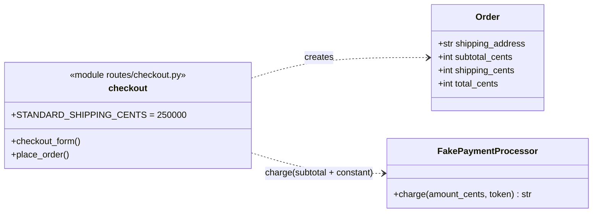

The fee and the "address is required" rule live inside the route. There is no concept of a fulfillment option.

### 7.2 Class diagram — after (M2)

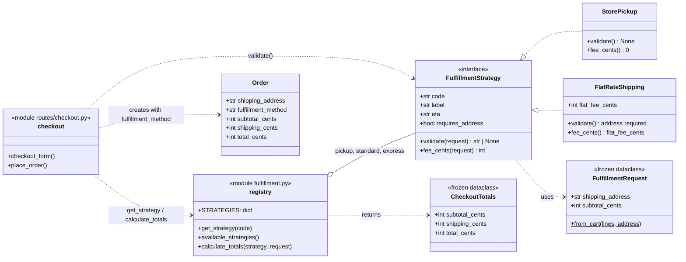

`standard` and `express` are two `FlatRateShipping` instances. `checkout` depends on the interface and the registry, never on a concrete option.

### 7.3 `place_order` — before and after

Before (fee and address rule hard-coded in the route):

```python
if not all([customer_name, customer_email, shipping_address, payment_token]):
    flash("Completa todos los campos del checkout.", "error")
    ...
subtotal = sum(line.line_total_cents for line in lines)
total = subtotal + STANDARD_SHIPPING_CENTS
payment_reference = FakePaymentProcessor().charge(total, payment_token)
order = Order(..., shipping_address=shipping_address,
              shipping_cents=STANDARD_SHIPPING_CENTS, total_cents=total, ...)
```

After (the route asks the selected strategy):

```python
strategy = get_strategy(request.form.get("fulfillment_method"))
if strategy is None:
    flash("Selecciona un método de entrega válido.", "error")
    ...
fulfillment_request = FulfillmentRequest.from_cart(lines, shipping_address)
validation_error = strategy.validate(fulfillment_request)
if validation_error:
    flash(validation_error, "error")
    ...
if not all([customer_name, customer_email, payment_token]):
    ...
totals = calculate_totals(strategy, fulfillment_request)
payment_reference = FakePaymentProcessor().charge(totals.total_cents, payment_token)
order = Order(...,
              shipping_address=fulfillment_request.shipping_address if strategy.requires_address else "",
              fulfillment_method=strategy.code,
              subtotal_cents=totals.subtotal_cents,
              shipping_cents=totals.shipping_cents,
              total_cents=totals.total_cents, ...)
```

Adding a fourth option, for example zone-based shipping, does not change this code.

## 8. Tests Added or Changed

`pytest` collects **49 tests** and all of them pass locally and in GitHub Actions. At the M1 baseline there were 12.

| File | Tests | What they cover |
|---|---|---|
| `tests/test_fulfillment.py` (new) | 11 | Unit tests of each strategy without Flask or a DB: the three options in order; the fee and address rule of each option, including a whitespace-only address; a missing code defaults to standard; an unknown code is rejected; subtotal and totals; **extensibility**: a distance-based strategy defined only in the test is registered and works without editing `fulfillment.py`. |
| `tests/test_checkout.py` (changed) | 14 (6 original + 8 new) | New: the form lists the three options with $2,500 and $5,900; missing method → `standard`; express persists its fee; pickup needs no address and does not store one even if one is sent; address handling uses the strategy's `requires_address`, not the `pickup` code; invalid method rejected; shipping without address rejected. |
| `tests/test_fulfillment_checkout.py` (new) | 10 (6 functions, 4 run for both `pickup` and `express`) | End-to-end with the new options: the payment is charged subtotal + fee; inventory decreases; a declined payment creates no order and keeps stock; the confirmation page and order history show the option; the option survives an app restart. |
| `tests/test_order_persistence.py` (new) | 8 | `fulfillment_method` is saved and read back; default `standard`; the migration adds the column to an old database, keeps old orders as `standard`, accepts new methods afterwards and is idempotent; every registered strategy can be persisted; the model default matches `DEFAULT_STRATEGY_CODE`. |
| `tests/test_cart.py`, `tests/test_catalog.py` | 6 | Unchanged. |

**How the original checkout tests were changed:**

- The 6 original checkout tests keep their names and assertions: order created, items persisted, inventory decreased, insufficient stock rejected, declined payment creates no order, order history.
- The shared helper `_checkout` gained two optional parameters, `fulfillment_method="standard"` and `address`, so the same helper can be reused for the new options.
- `test_checkout_happy_path_creates_order` gained assertions on the stored method and fee.
- A dedicated test (`test_checkout_defaults_missing_fulfillment_method_to_standard`) sends the old form without the new field, which proves the baseline request still works.

**Regression check with the untouched M1 tests:** we took the M1 versions of `conftest.py`, `test_cart.py`, `test_catalog.py` and `test_checkout.py` (`git show e020450:tests/...`) and ran them against the M2 code. Result: **12 passed**. The original suite, without any edits, still passes after the change.

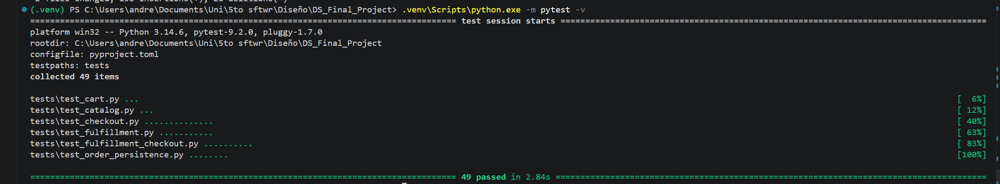

Local run with `.venv\Scripts\python.exe -m pytest -v`: **49 passed**. The output lists the six test files: the original `test_cart.py` and `test_catalog.py`, the extended `test_checkout.py`, and the new `test_fulfillment.py`, `test_fulfillment_checkout.py` and `test_order_persistence.py`.

## 9. Screenshots of the Working Fulfillment Options

### 9.1 Checkout — Standard Shipping

Address field visible and required; delivery $2,500.

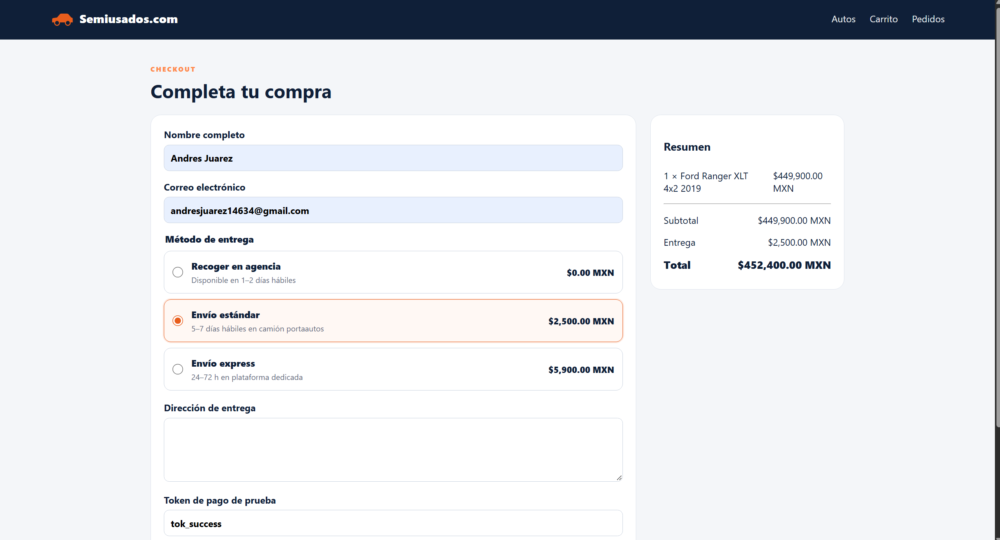

### 9.2 Checkout — Express Shipping

The summary updates to the $5,900 delivery fee and the new total.

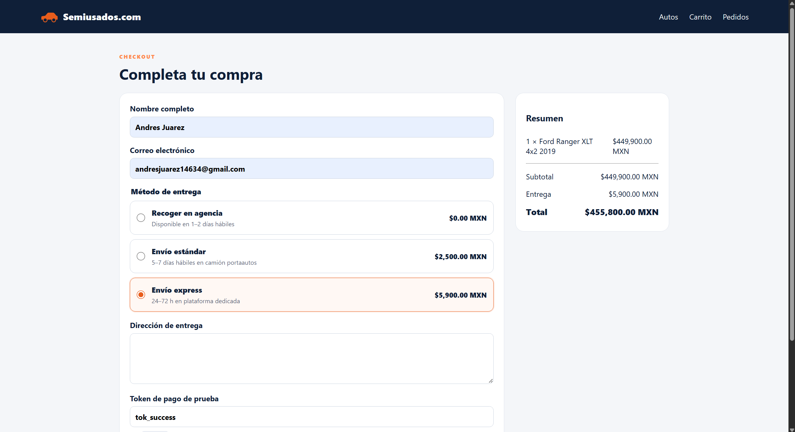

### 9.3 Checkout — Store Pickup

The address field is hidden; delivery $0, so the total equals the subtotal.

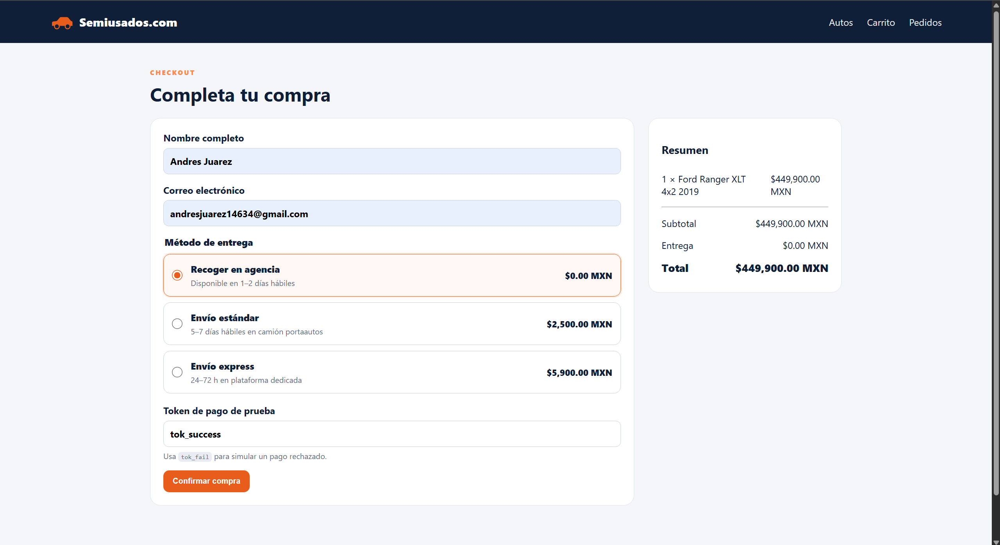

### 9.4 Validation — shipping without an address

With a shipping option selected, the address field becomes required, so the browser blocks the submission ("Please fill out this field"). This is only a usability check. The server applies the same rule through `strategy.validate()`, so a request that skips the browser is also rejected and no order is created (covered by `test_shipping_method_requires_address`).

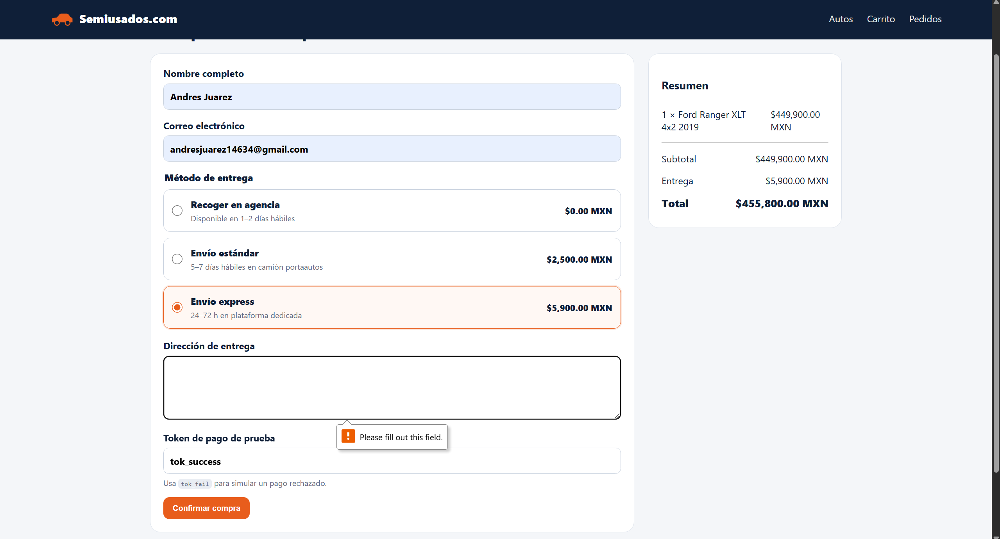

### 9.5 Order confirmation — Standard Shipping

The confirmation shows the chosen option ("Envío estándar"), its fee and the delivery address.

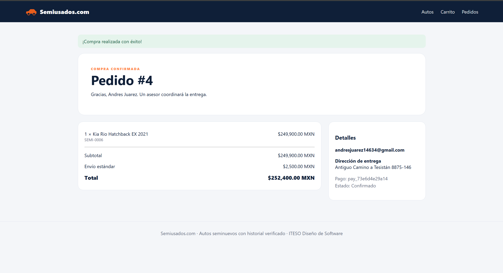

### 9.6 Order confirmation — Store Pickup

The confirmation shows "Recoger en agencia" with a $0 fee and no address.

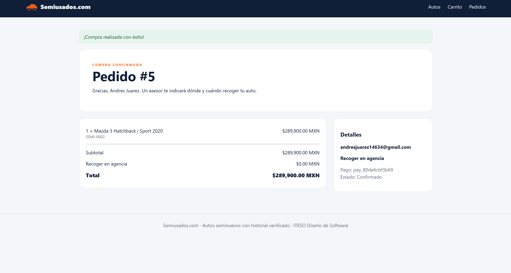

### 9.7 Order history

Each order in `/orders` shows the fulfillment option persisted with it:

- Orders #3–#5 were placed with the new options: express, standard and pickup.
- Orders #1 and #2 were placed on 2026-11-14, **before** this change, in the same `store.db`. After the migration added the column, they appear as "Envío estándar", the only option that existed then. This is the migration working on real existing data.

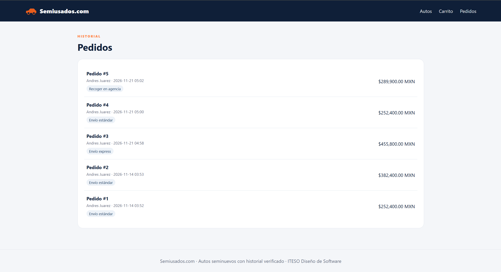

## 10. GitHub Actions Evidence

The `tests` workflow (`.github/workflows/tests.yml`, `pytest` on Ubuntu with Python 3.12) ran on every push and on every pull request of this milestone. **All runs passed**, including:

- the `pull_request` runs of PRs #4, #5, #6 and #7;
- the `push` runs on each feature branch;
- the `push` run on `main` after each merge. The last one is the merge of PR #7, with 49 tests.

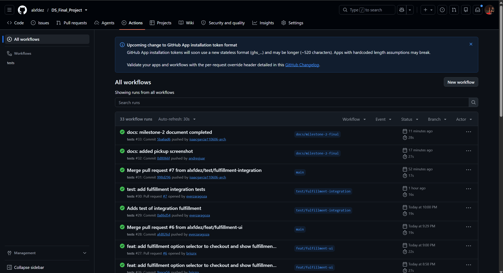

The Actions tab shows the `tests` workflow passing on the feature branches, on the pull requests (#6, #7) and on `main` after each merge. The two most recent runs are on `docs/milestone-2-final`, the branch of this document.

## 11. Git / PR Evidence

We used one branch and one pull request per part of the change, merged into `main` in dependency order:

| PR | Branch | Author | Reviewer | Content | CI |
|---|---|---|---|---|---|
| #3 | `feat/fulfillment-strategy` | Andres Juarez | Alejandro Fernández Arias (approved) | Strategy module, 11 unit tests, first version of this document | ✅ |
| #4 | `feat/order-fulfillment-column` | Alejandro Fernández Arias | Alejandro Amarillas Coronado (approved) | `fulfillment_method` column, idempotent migration, persistence tests | ✅ |
| #5 | `feat/checkout-fulfillment` | Alejandro Amarillas Coronado | Allison Briseyda Ávila Moctezuma (approved) | `place_order` / `checkout_form` use the strategies; fix to rely on `requires_address` | ✅ |
| #6 | `feat/fulfillment-ui` | Allison Briseyda Ávila Moctezuma | Ever Zaragoza Cerpas (approved) | Option selector, dynamic summary, option shown in confirmation and history | ✅ |
| #7 | `test/fulfillment-integration` | Ever Zaragoza Cerpas | Isaac Alejandro García Ruiz (approved) | End-to-end integration tests for the new options | ✅ |
| #8 | `docs/milestone-2-final` | Isaac Alejandro García Ruiz and Andres Juarez | Alejandro Fernández Arias (approved) | Completed documentation for the milestone | ✅ |

Each PR is small and focused on one concern, so it can be reviewed on its own. The commit history on `main` shows the order: strategy → persistence → checkout → UI → integration tests.


## 12. AI Use

- **Tool:** Claude Code (Anthropic).
- **What it helped with:**
  - Analyzing where the Change Request hits the current code and splitting the work into six parts.
  - Comparing Strategy against a data-only registry and `if/elif`.
  - Drafting `fulfillment.py` and its unit tests (PR #3).
  - Drafting this document, checking the merged code and tests against the requirements, and writing the before/after diagrams.
- **What the team decided or validated:**
  - Chose the Strategy pattern, following our advisor's recommendation.
  - Chose the adapted fees for car delivery.
  - Implemented and tested persistence, checkout, UI and integration tests (PRs #4–#7).
  - Ran the app manually and took the screenshots.
  - The team is responsible for, and able to explain, every statement in this document.
