# Milestone 3 — Marketplace Orders

> **Revisit component boundaries when a real change makes them hurt.**

## 1. Team & Repository

- **Team members:**
  - Andres Juarez
  - Alejandro Fernández Arias
  - Allison Briseyda Ávila Moctezuma
  - Isaac Alejandro García Ruiz
  - Alejandro Amarillas Coronado
  - Ever Zaragoza Cerpas
- **Store:** Semiusados.com, an online marketplace for inspected used cars.
- **Repository:** https://github.com/alxfdez/DS_Final_Project
- **Architecture decision record:** [`docs/adr/0001-shared-ordering-service.md`](adr/0001-shared-ordering-service.md)

## 2. Change Request Summary

The business signed an agreement with an external marketplace. Orders can now
enter the system from **two entry points**:

1. the existing **web storefront**;
2. a **marketplace API**.

A marketplace order provides:

- an external marketplace order ID;
- buyer information;
- shipping information;
- SKUs and quantities.

Requirements:

| # | Requirement | Where it is satisfied |
|---|---|---|
| R1 | Add a marketplace-facing entry point | `POST /api/marketplace/orders` (§9) |
| R2 | Marketplace orders must **not** charge our payment processor | `AlreadyPaid` payment method + architecture test (§5, §11) |
| R3 | Repeated requests for the same marketplace order must **not** create duplicates | `(source, external_order_id)` unique index + lookup in the service (§8) |
| R4 | Reuse the existing inventory, ordering and fulfillment capabilities | Both channels call `store.ordering.place_order` (§5) |
| R5 | Do not duplicate the complete checkout workflow | Checkout logic moved once into `ordering.py` (§7) |
| R6 | Preserve storefront behavior | All M2 storefront tests pass unchanged (§11) |
| R7 | Keep persistence consistent | Idempotent migration for M1/M2 databases, single commit per order (§8) |
| R8 | Tests + green GitHub Actions | 129 tests, Python 3.11–3.13 matrix, coverage ≥ 90% (§11, §12) |

## 3. Design Pressure Identified

At the end of M2, **the whole ordering workflow lived inside one Flask route**,
`routes/checkout.py::place_order`:

```text
place_order()  (72 lines, Flask route)
 ├─ read request.form + session cart          ← storefront-only
 ├─ get_strategy / strategy.validate          ← business rule
 ├─ required fields (name, email, token)      ← storefront-only
 ├─ stock check per line                      ← business rule
 ├─ calculate_totals                          ← business rule
 ├─ FakePaymentProcessor().charge(...)        ← varies by channel
 ├─ build Order + OrderItem, decrement stock  ← business rule
 ├─ db.commit()                               ← business rule
 └─ clear session cart, flash, redirect       ← storefront-only
```

Business rules and storefront details were mixed in the same function. A
marketplace endpoint had only bad options:

1. **Copy the function.** Stock, totals, fulfillment and persistence rules
   would then exist twice and drift apart. The Change Request explicitly
   forbids this.
2. **Call the route.** Not possible: it depends on `session`, `request.form`
   and `flash`, and it answers with HTML redirects.
3. **Add `if marketplace:` branches.** That would grow the function M1 (§5) and
   M2 (§4) already flagged as the most overloaded one, with two input formats,
   two payment behaviors and two response formats.

The pressure is specific. **One workflow now needs two entry points, and the
current boundary (the HTTP route) is the wrong owner for the business rules.**

## 4. Design Decision (summary)

We **extracted the ordering workflow into a module that does not use Flask**
(`store/ordering.py`). Both entry points became **thin adapters** around it.

**The only step that differs between channels is payment.** It is modeled as a
small protocol with two implementations:

- the storefront charges with our processor;
- the marketplace is "already paid".

This is the same move we made in M2 with `FulfillmentStrategy`: put the varying
behavior behind an interface instead of branching on the channel.

**Idempotency is a property of the order itself.** Each order stores
`(source, external_order_id)`, and the database enforces uniqueness.

The full reasoning, alternatives and consequences are in
[ADR 0001](adr/0001-shared-ordering-service.md). §13 summarizes the trade-offs.

## 5. New and Changed Boundaries

| Component | Status | Responsibility | Knows about | Does **not** know about |
|---|---|---|---|---|
| `store/ordering.py` | **New** | Place an order: idempotency lookup → fulfillment validation → SKU resolution → stock check → totals → payment → persist + decrement stock in one commit | `models`, `fulfillment`, `payments`, SQLAlchemy `Session` | Flask, HTTP, forms, JSON, session cart, which channel is calling |
| `routes/marketplace.py` | **New** | Authenticate the marketplace, validate the JSON, map domain errors to HTTP codes, serialize the order | `ordering` (`AlreadyPaid`, `PlaceOrder`, `OrderOrigin`), `SOURCE_MARKETPLACE` | Payment processor, storefront route, how stock/totals are computed |
| `routes/checkout.py` | **Changed** (`place_order`: 72 → 46 lines, including its docstring) | Read the cart and form, check that the form is complete, map domain errors to flash + redirect, clear the cart | `ordering` (`ChargeWithProcessor`, `PlaceOrder`), `FakePaymentProcessor` (it chooses the concrete processor) | Marketplace, how orders are persisted |
| `models.Order` | **Changed** | Adds `source`, `external_order_id` and the unique index `uq_orders_source_external_order_id` | — | — |
| `db.py` | **Changed** | `_upgrade_orders_table`: adds missing columns and the unique index to older databases | — | — |
| `fulfillment.py`, `payments.py` | **Unchanged** | Reused as they are by both channels | — | — |
| Templates `orders.html`, `order_confirmation.html` | **Changed** | Show a "Marketplace · \<id\>" label on marketplace orders, in the same order history | — | — |

### 5.1 The interface of the new boundary

```python
@dataclass(frozen=True)
class OrderOrigin:            # who sent it + their own ID (idempotency key)
    source: str
    external_order_id: str | None = None

@dataclass(frozen=True)
class PlaceOrder:             # channel-independent command
    customer_name: str
    customer_email: str
    lines: tuple[OrderLine, ...]          # OrderLine(sku, quantity)
    fulfillment_method: str | None = None
    shipping_address: str = ""
    origin: OrderOrigin = STOREFRONT_ORIGIN

class PaymentMethod(Protocol):            # the only step that varies by channel
    def collect(self, amount_cents: int) -> str: ...

class ChargeWithProcessor:  ...           # storefront: charges FakePaymentProcessor
class AlreadyPaid:          ...           # marketplace: returns "mkt_<id>", charges nothing

def place_order(db: Session, command: PlaceOrder, payment: PaymentMethod) -> PlacedOrder: ...
# PlacedOrder(order, created)  — created=False for a repeated external order
# raises InvalidFulfillment | InvalidOrder | UnknownSku | InsufficientStock | PaymentDeclined
```

Each domain error carries a message the user can read, and each adapter decides
how to present it:

| Error | Storefront | Marketplace |
|---|---|---|
| `InvalidFulfillment`, `InvalidOrder` | flash + back to checkout | 422 |
| `UnknownSku` | flash + back to cart | 422 |
| `InsufficientStock` | flash + back to cart | 409 + requested / available |
| `PaymentDeclined` | "El pago fue rechazado…" | cannot happen (`AlreadyPaid`) |

## 6. Dependency Direction

### 6.1 Before (end of M2)

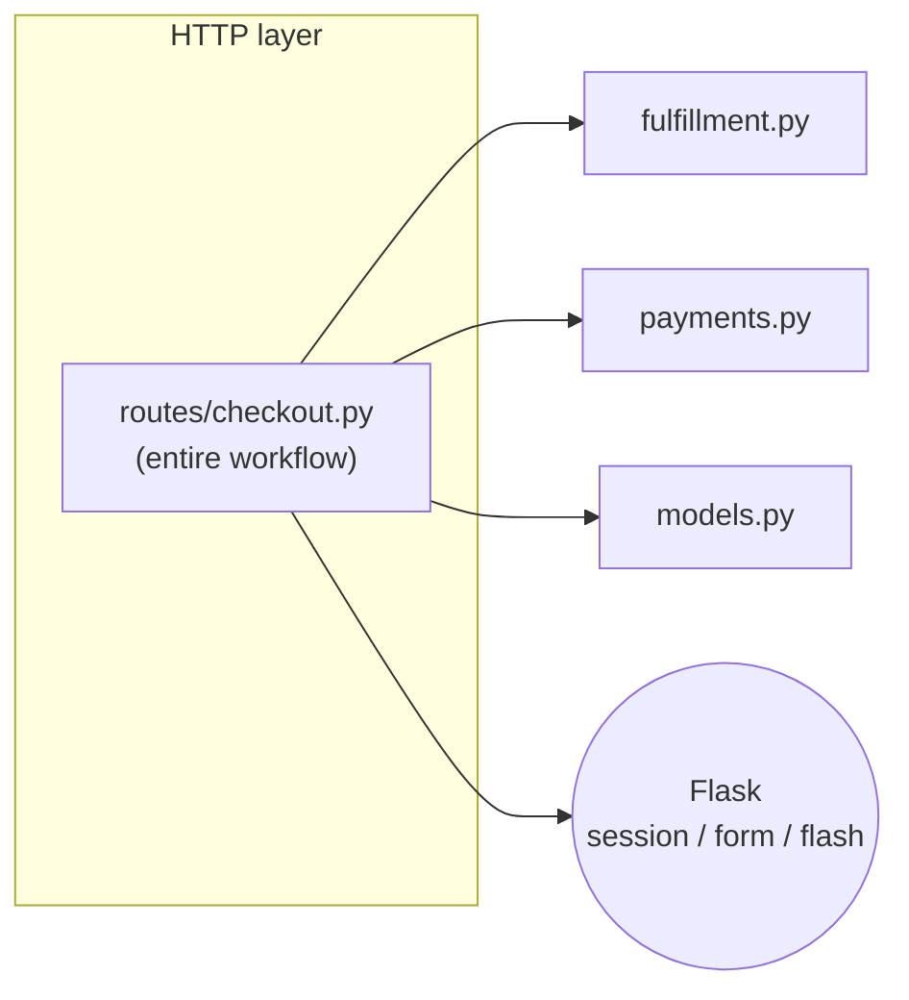

The business rules depended on Flask, because they lived inside a Flask route.

### 6.2 After (M3)

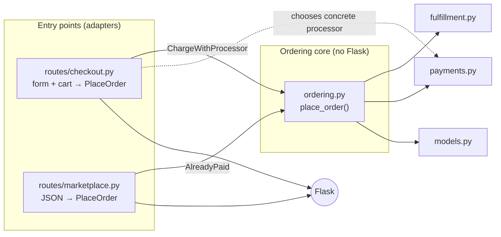

Rules:

1. Entry points depend on the core. **The core never imports Flask or `routes`.**
2. **Entry points do not depend on each other.**
3. **The marketplace route cannot reach the payment processor.** It imports
   only `AlreadyPaid`.

These rules are **tests, not only a diagram**. `tests/test_architecture.py`
parses the imports with `ast` and fails if one of them is broken:

| Test | Rule |
|---|---|
| `test_core_modules_do_not_depend_on_flask_or_routes[ordering.py / fulfillment.py / payments.py / models.py]` | 1 |
| `test_entry_points_do_not_depend_on_each_other[checkout ↔ marketplace]` | 2 |
| `test_marketplace_route_cannot_charge_the_payment_processor` | 3 |
| `test_both_entry_points_use_the_shared_ordering_service` | Both adapters go through the core |

## 7. Duplicated Knowledge

### 7.1 Removed

| Knowledge | Before | After |
|---|---|---|
| Choose + validate the fulfillment strategy | `checkout.place_order` | `ordering.place_order` (once) |
| Stock check | `checkout.place_order` | `ordering.place_order` (once, after merging repeated SKUs) |
| Totals (subtotal + strategy fee) | `checkout.place_order` | `ordering.place_order` → `calculate_totals` |
| Build `Order` + `OrderItem`, decrement stock, commit | `checkout.place_order` | `ordering.place_order` (one transaction, rollback on failure) |
| "Do not store an address for pickup" | `checkout.place_order` | `ordering.place_order` via `strategy.requires_address` |
| `"storefront"` / `"marketplace"` literals | — | `SOURCE_STOREFRONT` / `SOURCE_MARKETPLACE` constants in `models.py` |

The marketplace route has **no copy** of any row in this table.
`test_checkout_route_delegates_order_creation_to_ordering_service` also fails
if `checkout.py` ever builds `Order` / `OrderItem` itself again.

### 7.2 Deliberately retained

| Knowledge kept in two places | Why we kept it |
|---|---|
| **Input parsing:** form fields in `checkout.py`, JSON validation in `marketplace.py` | They are **different contracts**. One is an HTML form with a session cart and a payment token; the other is a JSON document with an external ID and an API key. Merging them would couple the storefront to the marketplace's format. |
| **"Required fields" check:** the storefront checks name/email/token in the route; the core also checks name/email | The token only exists in the storefront. The core's check protects any future caller. |
| **`_ResolvedLine.line_total_cents`** in `ordering.py`, similar to `CartLine.line_total_cents` | `CartLine` is a storefront (session cart) concept. Importing it into the core would reverse the dependency direction. It is one line of arithmetic. |
| **Error → response mapping**, once per adapter | Presenting errors is each channel's job: flash/redirect vs. HTTP status + JSON. |

## 8. Persistence and Idempotency

### 8.1 Schema

| Column | Type | Value |
|---|---|---|
| `source` | `VARCHAR(20) NOT NULL DEFAULT 'storefront'` | `storefront` or `marketplace` |
| `external_order_id` | `VARCHAR(80) NULL` | marketplace order ID; `NULL` for the storefront |
| **Unique index** `uq_orders_source_external_order_id` | `(source, external_order_id)` | SQLite allows many `NULL`s, so storefront orders never collide |

**Migration.** `db._upgrade_orders_table` now holds one ordered table of added
columns (`fulfillment_method` from M2, plus `source` and `external_order_id`).
On every app start it:

- adds the columns that are missing, with `ALTER TABLE`;
- creates the index with `CREATE UNIQUE INDEX IF NOT EXISTS`, because SQLite
  cannot add constraints with `ALTER TABLE`.

Databases created with the M1 and M2 schemas are upgraded in place. Their
orders become `storefront`. Running the upgrade again is safe.

### 8.2 Two layers of protection

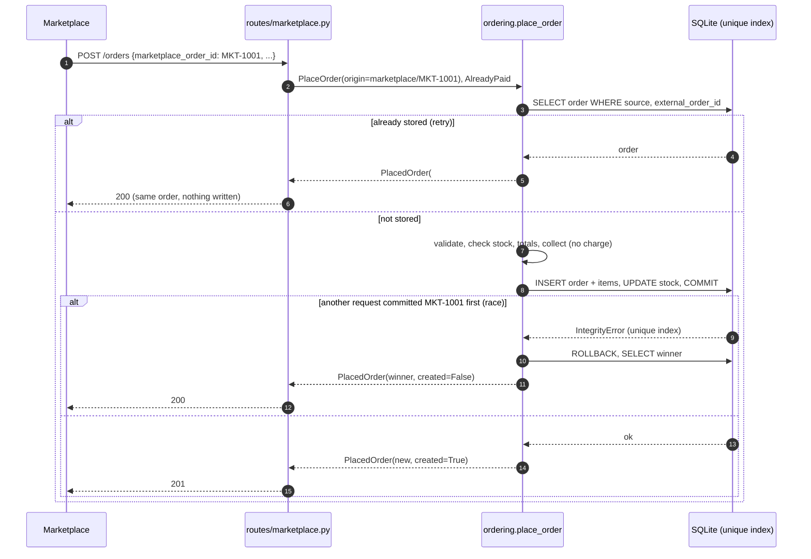

- **Layer 1: lookup first.** The service looks up the order **before** any
  validation or payment. A legitimate retry gets the original order even if
  the car sold out in between. Without this, the retry would look like a new
  order that fails.
- **Layer 2: unique index.** It is the real guarantee. If two requests pass the
  lookup at the same time, the database accepts only one commit. The service
  catches `IntegrityError` and re-reads the winner. An `IntegrityError` that
  is not a duplicate (no external ID, or no matching row) is re-raised.
- **Atomicity.** The order, its items and the stock decrement are written in
  **one commit**. Every failure (validation, payment, database) rolls back
  everything.

### 8.3 Evidence

Run against the real app (Werkzeug server, database seeded with `seed.py`),
sending real HTTP requests:

```text
== stock SEMI-0001 before: 3
== marketplace first:  HTTP 201  {"created": true,  "order_id": 1, "marketplace_order_id": "MKT-1001",
                                  "payment_reference": "mkt_MKT-1001", "total_cents": 23240000, ...}
== marketplace repeat: HTTP 200  {"created": false, "order_id": 1, "marketplace_order_id": "MKT-1001", ...}
== stock SEMI-0001 after both: 2          ← decremented once
== storefront checkout (pickup): HTTP 200 | success flash: True

== orders table
(1, 'marketplace', 'MKT-1001', 'standard', 23240000, 'mkt_MKT-1001')
(2, 'storefront',  None,       'pickup',   25990000, 'pay_f57f62b28c44')

== unique index
CREATE UNIQUE INDEX uq_orders_source_external_order_id ON orders (source, external_order_id)

== direct duplicate INSERT with sqlite3 (bypassing the app):
IntegrityError UNIQUE constraint failed: orders.source, orders.external_order_id
```

What it shows:

- the second request returns the same order without writing anything;
- the marketplace order has an `mkt_` reference, so no processor charge was made;
- both channels share one `orders` table;
- the database itself rejects a duplicate, even when the app is bypassed.

Automated tests covering this: §11.

## 9. Marketplace API Contract

```http
POST /api/marketplace/orders
Content-Type: application/json
X-Marketplace-Key: <MARKETPLACE_API_KEY>

{
  "marketplace_order_id": "MKT-1001",
  "buyer":    { "name": "Grace Hopper", "email": "grace@example.com" },
  "shipping": { "method": "standard", "address": "Av. Vallarta 123, Guadalajara" },
  "items":    [ { "sku": "SEMI-0001", "quantity": 1 } ]
}
```

| Field | Rule |
|---|---|
| `marketplace_order_id` | Required string, trimmed, **case-sensitive**, max 64 chars (`mkt_` + ID must fit `payment_reference VARCHAR(80)`; SQLite does not enforce `VARCHAR` lengths, so the API does) |
| `buyer.name`, `buyer.email` | Required |
| `shipping.method` | Optional: `pickup` / `standard` / `express`; defaults to `standard`, as in the storefront |
| `shipping.address` | Required by `standard` / `express`, ignored by `pickup` (the same strategy rules) |
| `items[]` | Non-empty; each item has `sku` and a positive integer `quantity` (`true` / `false` are rejected); repeated SKUs are merged |

| Result | Status | Example body |
|---|---|---|
| Created | **201** | `{"created": true, "order_id": 1, ...}` |
| Same `marketplace_order_id` again | **200** | Same order, `"created": false` |
| Missing / wrong key | 401 | `{"error": "Missing or invalid API key."}` |
| Malformed payload | 400 | `{"error": "Invalid order payload.", "details": ["marketplace_order_id is required", "items must be a non-empty list"]}` |
| Unknown / inactive SKU, invalid fulfillment | 422 | `{"error": "El SKU … no existe o no está disponible."}` |
| Not enough stock | 409 | `{"details": ["sku SEMI-0002: requested 99, available 2"], ...}` |

**Authentication:**

- shared secret in `MARKETPLACE_API_KEY` (env var; dev default `dev-marketplace-key`);
- compared with `hmac.compare_digest`;
- an empty key rejects every request.

Example with `curl` (app running with `flask --app store run`):

```bash
curl -i -X POST http://127.0.0.1:5000/api/marketplace/orders \
  -H "Content-Type: application/json" \
  -H "X-Marketplace-Key: dev-marketplace-key" \
  -d '{"marketplace_order_id":"MKT-1001","buyer":{"name":"Grace Hopper","email":"grace@example.com"},"shipping":{"method":"standard","address":"Av. Vallarta 123"},"items":[{"sku":"SEMI-0001","quantity":1}]}'
```

## 10. Storefront and Marketplace Flows

### 10.1 Storefront checkout (unchanged for the customer)

The customer adds a car to the cart, chooses a fulfillment option and pays with
a test token. The pages, messages and fees are the same as in M2.

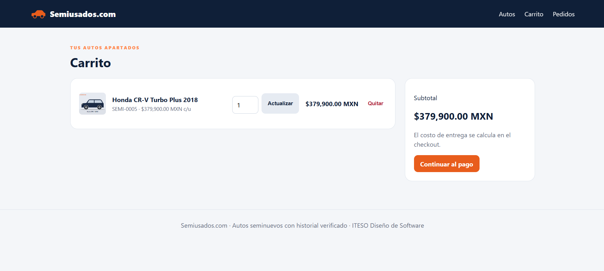

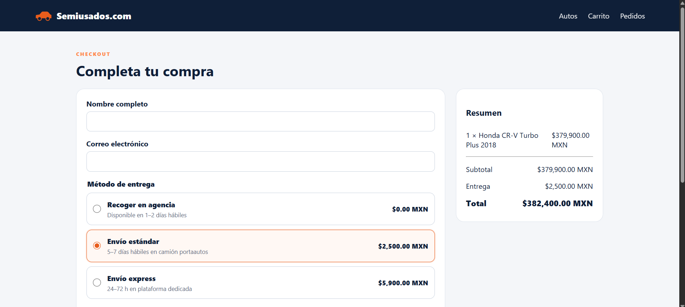

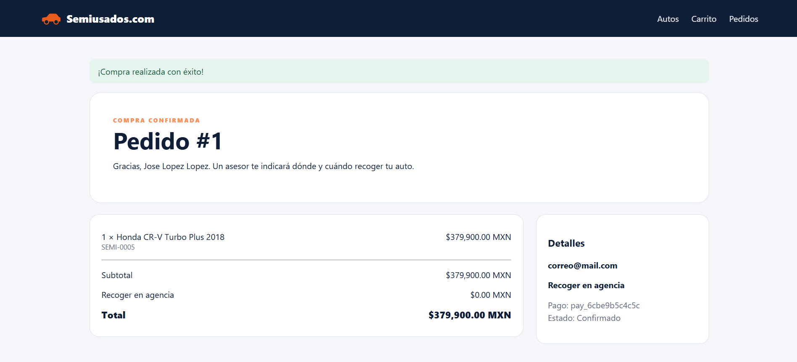

### 10.2 Marketplace order: first request (201) and retry (200)

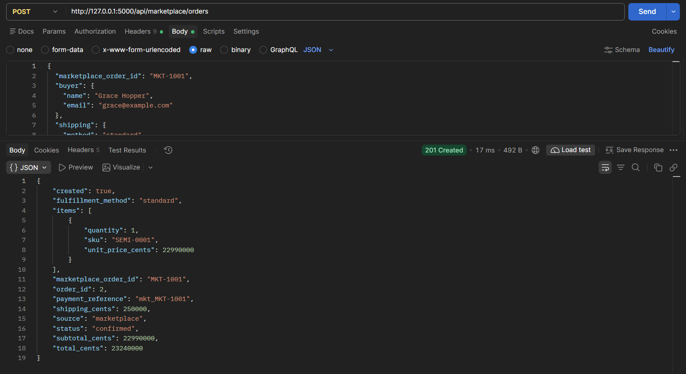

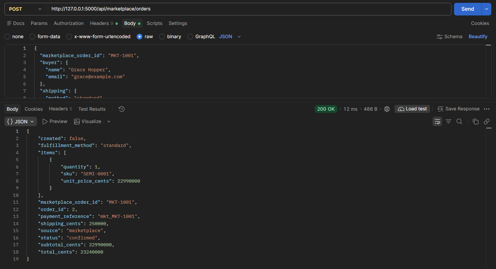

### 10.3 One shared order history

Marketplace orders appear in `/orders` next to storefront orders, with a
"Marketplace · \<id\>" label. The detail page shows the origin and the
`mkt_…` payment reference.

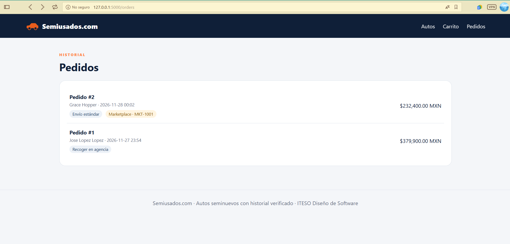

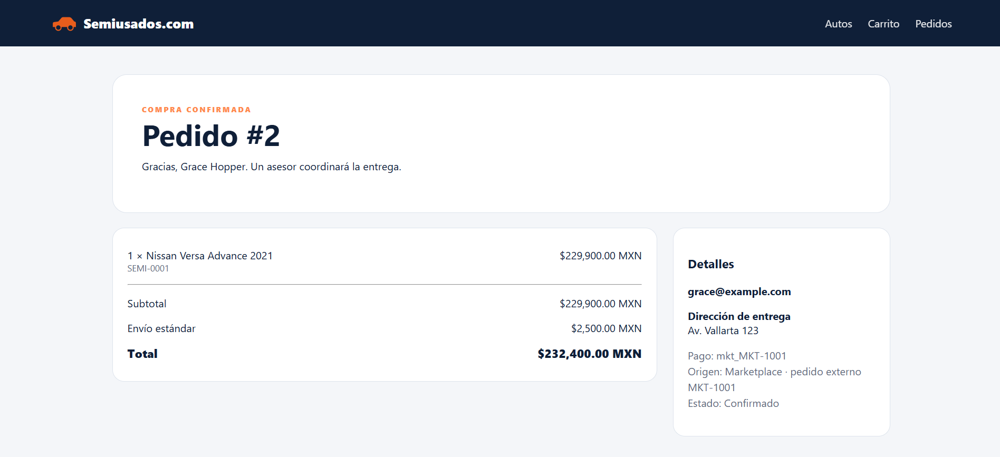

## 11. Automated Tests

`pytest` collects **129 tests**, and all of them pass locally and in GitHub
Actions. At the end of M2 there were 49.

| File | Tests | Status | What it covers |
|---|---:|---|---|
| `tests/test_ordering.py` | 28 | **New** | The core without HTTP: happy path, total charged, `AlreadyPaid` never calls the processor, pickup/default strategy, repeated SKUs merged, 9 invalid orders rejected **before payment with nothing written**, declined payment, origin persisted, **a repeat returns the existing order with stock decremented once**, a retry after sell-out returns the original, storefront orders never deduplicated, **simulated race through the `IntegrityError` path**, failed commit rolls back, a non-duplicate `IntegrityError` is re-raised |
| `tests/test_marketplace_api.py` | 24 | **New** | HTTP contract. A fixture makes **every test fail if the payment processor is called**. Also: 201 → 200 with the same order, whitespace in IDs, order visible in history, pickup without address, 401 ×2, **13 malformed payloads → 400**, non-JSON body, 422, 409 with nothing written |
| `tests/test_cross_channel.py` | 7 | **New** | **Shared inventory in both directions**, one order history, same ID + different payload → original order, **idempotency survives an app restart**, case-sensitive IDs, inactive SKU |
| `tests/test_architecture.py` | 8 | **New** | Dependency direction (§6) |
| `tests/test_order_persistence.py` | 19 | 8 + **11 new** | Origin defaults, many `NULL` external IDs coexist, duplicate `(source, id)` rejected, same ID in another source allowed, unique index exists, **M1 and M2 databases upgraded**, uniqueness after upgrade and after restart |
| `tests/test_checkout.py` | 16 | 14 + **2 new** | New: incomplete form rejected; the route delegates to the service and does not build `Order` / `OrderItem` itself |
| `tests/test_fulfillment.py`, `test_fulfillment_checkout.py`, `test_cart.py`, `test_catalog.py` | 27 | Unchanged | — |

**Storefront behavior preserved.** The 14 M2 checkout tests, the 10
fulfillment-checkout tests and the cart/catalog tests **pass without edits**
after the refactor (PR #10). The only behavior difference is an edge case. When
a form has *several* problems at once, the "Completa todos los campos" message
now wins over a fulfillment error. Forms with a single problem behave exactly
as before.

**Coverage** (branch coverage, `pytest --cov`): **96.96%** in total, and
**100%** for `ordering.py`, `routes/marketplace.py`, `fulfillment.py` and
`models.py`.

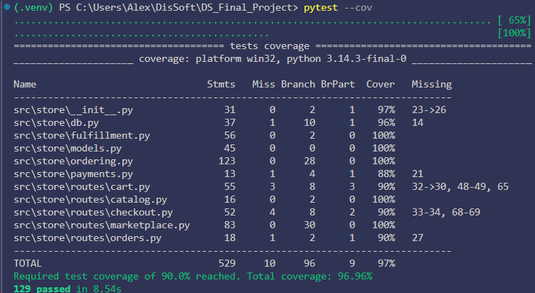

## 12. CI Evidence

`.github/workflows/tests.yml` now:

- runs on **Python 3.11, 3.12 and 3.13**, with `fail-fast: false`. 3.11 is the
  lowest version allowed by `requires-python`;
- runs `pytest --cov` with **`fail_under = 90`**, so CI fails if coverage drops;
- publishes a coverage table in the job summary.

Every PR of this milestone passed CI before merging. PR #13 passed all three
versions of the matrix.

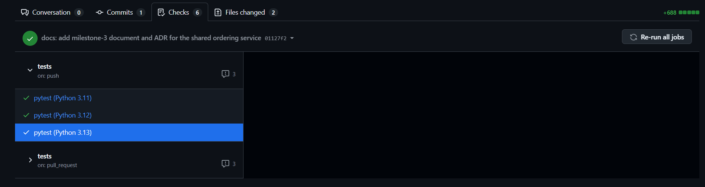

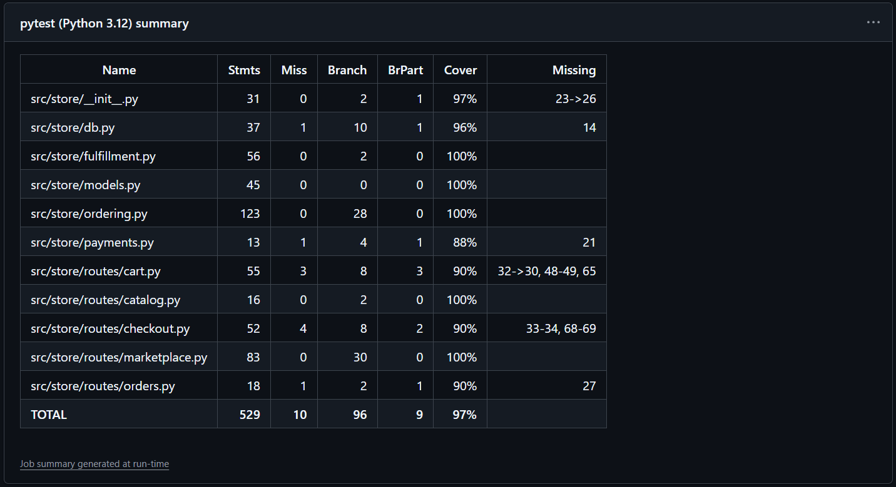

## 13. Architectural Decisions and Trade-offs

### 13.1 What we chose and why

| Decision | Why |
|---|---|
| **Extract one ordering service** (a module + one function) | It is the smallest change that gives both channels the same rules. The marketplace needed exactly what the route did, minus the Flask parts. |
| **Payment as a protocol** (`ChargeWithProcessor` / `AlreadyPaid`) | Payment is the *only* step that differs. Modeling that behavior avoids `if source == ...` branches in the core, as `FulfillmentStrategy` did in M2. |
| **Idempotency key on the order row + unique index** | The key is a natural attribute of the order, so one table, one write and one guarantee from the database. It survives restarts and races. |
| **Repeat → 200 with the original order** | A retry is normal for an integration, not an error. |
| **Architecture rules as tests** | A diagram can go out of date silently; a failing test cannot. |

### 13.2 What we did **not** adopt

| Not adopted | Why not (for this change) |
|---|---|
| Full hexagonal / clean architecture (ports, repositories, unit of work, DTO mappers) | Same dependency direction, many more files. SQLAlchemy's `Session` already is the unit of work, and one extra entry point does not justify a repository layer. |
| Separate marketplace service or a message queue | The marketplace calls synchronously and retries. A queue adds infrastructure and eventual consistency to a problem a unique index solves. |
| Separate `idempotency_keys` table / in-memory cache | Two writes to keep consistent, or state lost on restart. |
| Payload hashing to reject "same ID, different content" | Correct, but it adds a column and more rules for a case the Change Request does not mention. It is listed as debt. |
| Migration framework (Alembic) | Three added columns and one index are still cheaper by hand. Listed as debt. |

### 13.3 Trade-offs

**What we gain:**

- **One place for the ordering rules.** A future third channel (for example a
  phone-sales console) only needs an adapter.
- **The core is tested without HTTP.** 28 fast tests drive it directly.
- **Two guarantees enforced by structure, not only by convention:**
  - "the marketplace never charges" (imports checked by a test);
  - "no duplicates" (enforced by the database).
- **The storefront is unchanged for customers**, as the unedited tests show.

**What it costs:**

- **One more module and four concepts:** command, payment protocol, result,
  and domain errors (285 lines in `ordering.py`, including docstrings).
- **Every entry point must map domain errors to its own responses.**
- **`place_order` changed its return type** (`Order` → `PlacedOrder`), so
  callers had to adapt.
- **The core returns Spanish user-facing messages**, which mixes presentation
  with business rules.

**Our judgment:** the cost is one module with a small, typed interface. In
return, the most overloaded function in the system becomes a 46-line adapter,
the marketplace route has no business rules, and the two hardest requirements
(no charge, no duplicates) are checked by structure and by the database. For a
change that introduces a second entry point, we believe this is the
proportional response.

## 14. Remaining Technical Debt

| # | Debt | Impact | Possible next step |
|---|---|---|---|
| 1 | Same `marketplace_order_id` with a **different payload** silently returns the original order | A marketplace bug could go unnoticed | Store a payload hash; answer 409 on mismatch |
| 2 | The stock check and decrement are a **read-then-write** without row locking | Under real concurrency on a server database, two orders could oversell | `UPDATE … SET stock = stock - n WHERE stock >= n`, or `SELECT … FOR UPDATE` on PostgreSQL |
| 3 | The race test **simulates** the race (forced lookup miss) | It proves the `IntegrityError` branch, not real parallel timing | Run a concurrent test on a server database |
| 4 | **Single shared API key**, with a dev default in code | No per-partner revocation; a misconfigured deploy would accept the default key | Per-partner keys / signed requests; refuse to start without a key outside development |
| 5 | **Hand-written SQLite migrations** in `db.py` | Each new column is manual work; no downgrade | Adopt Alembic when schema changes become frequent |
| 6 | **Spanish user messages produced by the core** | Presentation mixed with business rules; harder to translate the API | Error codes in the core, with text in each adapter |
| 7 | Marketplace orders get our **shipping fee calculation**, not the amount the marketplace charged | Totals may differ from what the buyer actually paid | Accept the marketplace totals and store them separately |
| 8 | `src/*.egg-info` is **versioned in git** | `pip install -e` leaves the working tree dirty | Remove it from the repo and add `*.egg-info/` to `.gitignore` |
| 9 | No marketplace **status callbacks** (shipped, cancelled) | The marketplace cannot track fulfillment | Only if the business asks for it |

## 15. Git / PR Evidence

One branch and one pull request per part of the change, merged into `main` in
dependency order:

| PR | Branch | Author | Reviewer | Content | CI |
|---|---|---|---|---|---|
| #9 | `feat/milestone-3-ordering-service` | Andres Juarez | Allison Briseyda Ávila Moctezuma (approved) | `ordering.py`, the service without Flask; 19 unit tests + architecture test | ✅ |
| #10 | `refactor/checkout-uses-ordering-service` | Allison Briseyda Ávila Moctezuma | Isaac Alejandro García Ruiz (approved) | Storefront checkout becomes a thin adapter; storefront tests pass unedited | ✅ |
| #11 | `feat/order-origin-persistence` | Isaac Alejandro García Ruiz | Alejandro Fernández Arias (approved) | `source` / `external_order_id`, unique index, M1/M2 database upgrade | ✅ |
| #12 | `feat/marketplace-orders-api` | Alejandro Fernández Arias | Ever Zaragoza Cerpas (approved) | Idempotency in the service, `POST /api/marketplace/orders`, marketplace label in history | ✅ |
| #13 | `test/cross-channel-and-ci-milestone3` | Ever Zaragoza Cerpas | Andres Juarez | Cross-channel + architecture tests, coverage ≥ 90%, Python 3.11–3.13 matrix | ✅ |
| #14 | `docs/milestone-3` | Alejandro Amarillas Coronado y Alejandro Fernández Arias | Andres Juarez | This document and ADR 0001 | ✅ |

Review comments were not only approvals. They led to code changes:

- the review of #11 asked for the 64-character limit, rejection of blank IDs,
  source constants and a documented case rule. All four were implemented in #12;
- the review of #12 asked for the cross-channel tests and the CI matrix added
  in #13.

## 16. AI Use

- **Tool:** Claude Code (Anthropic).
- **What it helped with:**
  - analyzing where the Change Request hits the code and splitting the work
    into six parts;
  - proposing the shared ordering service and the payment protocol, and
    comparing them with copying the route, `if` branches, hexagonal
    architecture and a queue;
  - drafting the code and tests of each PR as patches;
  - drafting review comments, this document and ADR 0001, and checking the
    numbers in this document (test counts, coverage, HTTP evidence) against
    real runs.
- **What the team decided or validated:**
  - applied, ran and committed each patch on its own branch;
  - reviewed each PR before merging;
  - decided the open questions (repeat → 200, case-sensitive IDs, our shipping
    fee for marketplace orders);
  - ran the app manually and took the screenshots.
- **Critical review:** some AI suggestions were corrected before merging. For
  example, a first version of the race test did not really reach the
  `IntegrityError` path, and it was fixed before PR #12. The team is
  responsible for, and able to explain, every statement in this document.
